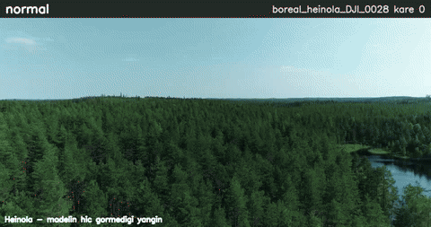
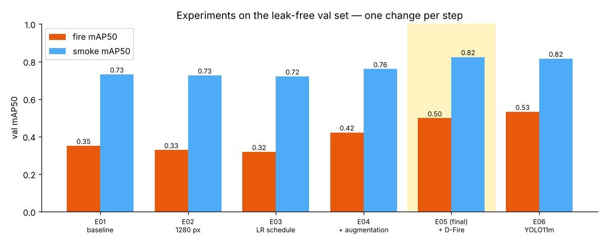
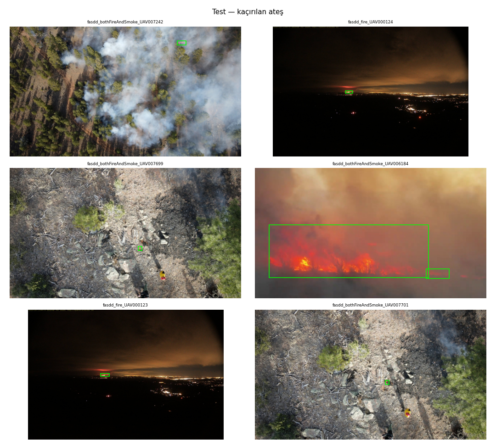
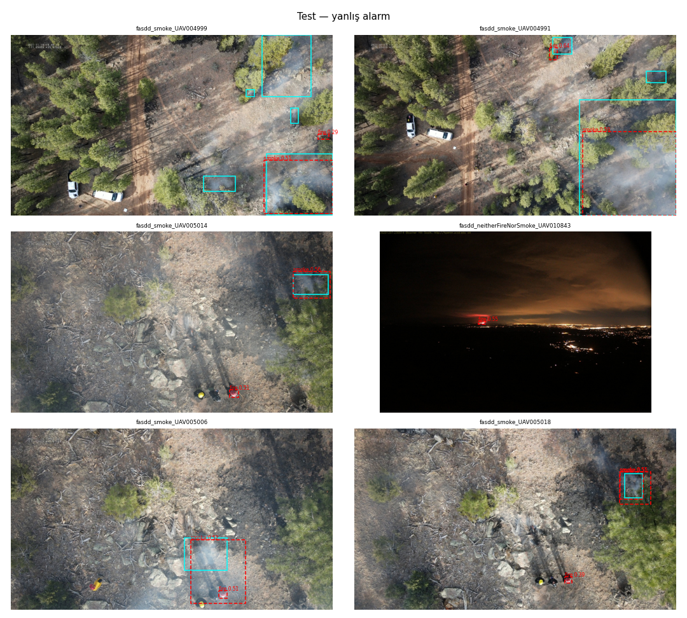

# Wildfire smoke & fire detection from drone imagery

YOLO11 detector for **fire** and **smoke** in aerial / UAV footage, built around one rule: *the numbers must hold on scenes the model has never seen*. The final model runs with ONNX Runtime alone (no PyTorch) and adds a temporal alarm filter on top of per-frame detections.



*Held-out Heinola fire, never seen in training. Orange = fire, blue = smoke, thin green = ground truth; the top bar turns red when the temporal filter raises an alarm. Full video and model: see **Releases**.*

| | |
|---|---|
| **Model** | YOLO11s, 640 px, ~9.4 M parameters, ONNX (`predict.py`, CPU-only) |
| **Data** | FASDD_UAV + Boreal Forest Fire (Finland) + D-Fire, re-split by scene with DINOv2 de-duplication |
| **Unseen fire event (Heinola)** | smoke found in **94 %** of frames, **0 %** false alarms, mAP50 **0.94** |
| **Test set, frame level** | fire **90 %** / smoke **95 %** of frames detected, false alarms **2.0 %** / **0.3 %** |
| **vs. baseline (same test set)** | mAP50 0.47 → **0.56**, fire frames detected 78 % → **90 %** |

---

## 1. The finding that shaped the project: the official split leaks

FASDD_UAV ships with a train/val/test split. In that split, **93 % of the test images (3,894 of 4,181) have a near-identical copy in train/val** — perceptual-hash distance ≤ 4 bits, i.e. the same scene a few video frames apart. DINOv2 embeddings later showed the whole dataset comes from only **~190 independent scenes**. A model evaluated on the official split is graded on memory, not generalisation.

What I did instead (`03_merge_split`, `04_dedup`):

1. **Near-duplicate graph.** pHash (≤ 8 bit) links obvious copies; DINOv2-ViT-S/14 cosine similarity links frames of the same scene that pHash misses.
2. **Data-driven threshold.** τ = 0.936 is the 99th percentile of similarity between *different* Boreal fire events (Heinola vs. the others) — "as similar as two different fires ever get". Pairs on both sides of τ were checked by eye.
3. **Group split.** Connected components = scenes; whole scenes go to one split, balanced by category (fire+smoke / fire / smoke / none).
4. **A whole fire held out.** All frames of the **Heinola** fire (Boreal dataset) are test-only: an event the model never sees in any form.

Result: FASDD test images with a train/val neighbour above τ went from **1,205 → 0**. Final split (v2): **22,124 train / 3,651 val / 4,271 test** (test = FASDD 3,148 + Heinola 1,123).

## 2. Experiments — one change at a time, judged on val

| Exp | Change | fire mAP50 | smoke mAP50 | mAP50-95 |
|---|---|---|---|---|
| E01 | baseline: YOLO11s, 640, 100 ep, early stop | 0.351 | 0.731 | 0.265 |
| E02 | 1280 px | 0.328 | 0.726 | 0.259 |
| E03 | proper LR schedule (40 ep, no early stop) | 0.318 | 0.721 | 0.282 |
| E04 | + strong augmentation (scale, translate, mixup, brightness) | 0.422 | 0.760 | 0.308 |
| **E05** | **+ D-Fire added to train only (de-duplicated against val/test)** | **0.498** | **0.824** | **0.371** |
| E06 | E05 with YOLO11m | 0.532 | 0.815 | 0.377 |



**Why 1280 px did not help — a diagnosis instead of a guess** (`05b_diag`). E01 and E02 plateaued at the same val score. Two hypotheses, measured separately:

- *Scene memorisation:* fire mAP50 was **0.85 on training images vs 0.35 on val**. Confirmed → the remedy is diversity (E04 augmentation, E05 more scenes), not resolution.
- *Label granularity:* **89 % of val fire boxes come from two scenes** where flames are annotated as 8–12 small boxes per frame. The model found fire in **100 %** of those frames but split it differently, so IoU-0.5 matching counted misses. Box mAP therefore understates fire performance; I report frame-level and pixel-coverage metrics next to mAP from here on.

**Choosing E05 over E06.** E06 has better fire boxes (fire box recall 0.45 vs 0.36) but at the operating point it detects fire in the same share of frames (91.9 %), raises false alarms (fire 1.0 → 1.8 %, smoke 1.1 → 1.9 %), detects less smoke (89.7 → 85.6 %) and costs 3× the compute (68 vs 21 GFLOPs). For a drone, E05 is the better trade.

## 3. Final evaluation — test set opened once

Model and thresholds were frozen before looking at test. Confidence thresholds were chosen on **val** as the lowest value keeping frame-level false alarms ≤ 1 %: **fire 0.25, smoke 0.30**.

**Box metrics (Ultralytics mAP)**

| test subset | class | final mAP50 | final mAP50-95 | baseline mAP50 |
|---|---|---|---|---|
| all | all | **0.560** | 0.296 | 0.473 |
| all | fire | 0.249 | 0.076 | 0.182 |
| all | smoke | 0.871 | 0.517 | 0.764 |
| Heinola (unseen fire) | smoke | **0.939** | 0.516 | 0.816 |

**Frame level — "is there fire/smoke in this frame?"**

| class | subset | detected | false alarm | baseline detected | baseline false alarm |
|---|---|---|---|---|---|
| fire | FASDD test | **90.2 %** | 2.8 % | 77.8 % | 2.6 % |
| smoke | FASDD test | **95.8 %** | 0.4 % | 84.3 % | 0.1 % |
| smoke | Heinola | **94.0 %** | **0.0 %** | 99.1 % | 12.0 % |
| fire | Heinola (no fire present) | – | **0.0 %** | – | 0.1 % |

On the unseen fire the baseline flagged almost everything, including 12 % of smoke-free frames; the final model is nearly as sensitive and practically never fires falsely. Fire **box** mAP is low on test (0.25) for the same reason as on val — the test fire frames come from only 13 scenes, some densely annotated — while fire is found in 90 % of frames and 74 % of fire pixels are covered.

## 4. Error analysis

| failure | example | likely cause |
|---|---|---|
| missed small fire | ember under smoke, thin fire line on the horizon at night | targets < 10 px at 640; very few night images |
| missed large fire | flame front behind dense orange smoke | fire and smoke colours merge |
| false fire alarm | red equipment next to a firefighter | red/orange objects |
| "false" alarm that is a label issue | ember at the smoke source labelled smoke-only; the same night glow labelled fire in one frame, nothing in another | FASDD annotation inconsistency |
| late smoke detection | distant white plume against hazy sky (Heinola) | trade-off learned against clouds; misses cluster in short runs of one video |




## 5. Deployment: ONNX + temporal alarm

`predict.py` needs only `onnxruntime`, `opencv-python` and `numpy` (37.9 MB model, **~32 ms per frame on a Colab CPU**). It raises an alarm only when a class is seen in **at least K of the last N frames** (default 3 of 5), so single-frame false positives do not trigger it.

Download `firesmoke_y11s_640.onnx` from **Releases** into `models/`, then:

```bash
pip install -r requirements.txt
python predict.py --model models/firesmoke_y11s_640.onnx --source drone.mp4 --out result.mp4
python predict.py --model models/firesmoke_y11s_640.onnx --source frames/ --out annotated/
# long videos: analyse every 5th frame (30 fps → 6 fps, ~5× faster); the alarm window then counts analysed frames
python predict.py --model models/firesmoke_y11s_640.onnx --source drone.mp4 --out result.mp4 --stride 5
```

The output video is scaled to at most 1280 px wide (`--out-width`, detection itself runs on the full frame); a JSON log with per-frame detections, alarm state and timestamps is written next to it.

**Checks.** In a unit test `predict.py` matches Ultralytics' own ONNX inference box-for-box. Against PyTorch inference on 200 test images, 84 % of boxes match at IoU > 0.9 with a mean confidence difference of 0.02. The most likely cause is that Ultralytics runs PyTorch on rectangular input (e.g. 640×480) while the exported model uses a fixed 640×640 letterbox; the comparison included boxes down to conf 0.05, where small shifts matter most.

**Event-level behaviour on the unseen Heinola fire** (1,123 frames; 8 videos contain smoke; alarm = 3 of last 5 frames):

| | per-frame detection | with temporal filter |
|---|---|---|
| smoke frames detected | 94.5 % | 94.5 % |
| smoke-free frames flagged | 0.0 % | 3.7 % |
| fire alarms (no fire present) | 0.0 % | 0.0 % |

- An alarm was raised in **7 of 8 videos**, typically **2 frames after smoke first appears** — the minimum the 3-of-5 rule allows.
- The 3.7 % "false" alarm frames with the filter are the hold-off: the alarm stays on until 5 consecutive frames are clear, so it outlasts the smoke by a few frames. That is intended behaviour, not new detections.
- **One miss at event level:** in `DJI_0048` smoke enters at frame 41 of 62 and the model never confirms it — the distant-plume-against-haze failure from the error analysis.
- Heinola frames are sampled from the original videos, so "frames" here are not a fixed time step; time-to-alarm in seconds could not be measured.

## 6. Limitations — read before using

This is a **prototype / operator-assistance tool, not a safety system**.

- **Narrow test coverage.** Test fire comes from 13 scenes; the held-out event (Heinola) has smoke labels only. Confidence intervals are wide; other regions (e.g. Mediterranean pine forests), seasons, altitudes and cameras are untested.
- **Frames, not events.** Field systems are judged on *time to alarm* and *false alarms per hour* on continuous video. The available footage is sparsely sampled, so those were not measured.
- **Weakest where it matters most.** Early fires are small; fires under ~10 px and night scenes are the main misses.
- **Label noise.** FASDD annotations are inconsistent in places (see error analysis); metrics inherit that noise.
- **Visible light only.** Operational wildfire systems usually add thermal (IR) cameras.

Next steps toward real use: continuous drone video from the target region with event-level evaluation, more night/small-fire data, thermal input, an on-board latency benchmark, and a field trial with a human in the loop.

## 7. Reproduce

All steps are Colab notebooks in `notebooks/` (Google Drive for storage; comments in Turkish). Versions are pinned (Ultralytics 8.4.183). Generated reports — audit, dataset splits, experiment logs, final evaluation — are in `reports/`.

| notebook | step |
|---|---|
| `01_download` | fetch FASDD_UAV, D-Fire; Boreal is downloaded manually from Fairdata |
| `02_audit` | class/box statistics, duplicates, visual checks |
| `03_merge_split` | unify labels (0 = fire, 1 = smoke), pHash groups, scene-level split (v1) |
| `04_dedup` | DINOv2 de-duplication, calibrated threshold, v2 split |
| `04b_add_dfire` | add D-Fire to train only, removing images similar to val/test (v3) |
| `05_train*` | training runs E01–E06 (E01/E02: `05_train` with the settings logged in `reports/experiments.csv`) |
| `05b_diag` | diagnosis: train-vs-val gap, IoU sweep, pixel coverage, per-scene, per-size |
| `06_eval` | thresholds on val, single test evaluation, error grids |
| `07_export_demo` | ONNX export + verification, demo video, figures |

## Data & license

- **FASDD_UAV** — Flame and Smoke Detection Dataset, UAV subset (used via a Hugging Face mirror).
- **Boreal Forest Fire, Subset A** — drone videos of Finnish forest fires, [Fairdata](https://etsin.fairdata.fi/dataset/1dce1023-493a-4d63-a906-f2a44f831898).
- **D-Fire** — fire and smoke images (mostly ground cameras), [GitHub](https://github.com/gaiasd/DFireDataset).

Datasets are not redistributed here; each is subject to its own license. The model is trained with [Ultralytics YOLO](https://github.com/ultralytics/ultralytics) (AGPL-3.0), so this repository and the exported weights are released under **AGPL-3.0**.
